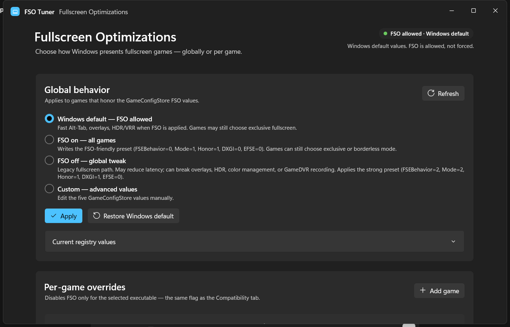

# FSO Tuner

A native Windows 11 app for controlling **Fullscreen Optimizations (FSO)**. Built with C# and WinUI 3 / Windows App SDK, not Electron, not a web wrapper.



## What it does

- Reads the current FSO values from `HKCU\System\GameConfigStore`.
- Applies four global modes:
  - **Windows default (FSO allowed)**, removes the five FSO overrides. FSO is allowed, not guaranteed for every game.
  - **FSO on (all games)**, writes the FSO-friendly preset:
    `FSEBehavior=0`, `FSEBehaviorMode=1`, `HonorUser=1`, `DXGI=0`, `EFSE=0`.
    This is a preference; games can still choose exclusive or borderless mode.
  - **FSO off (global tweak)**, writes the strong preset:
    `FSEBehavior=2`, `FSEBehaviorMode=2`, `HonorUser=1`, `DXGI=1`, `EFSE=0`.
    May affect overlays, HDR, color management, and GameDVR recording in exclusive fullscreen.
  - **Custom (advanced values)**, edits each of the five DWORDs directly, including the full EFSE bitmask range (`0–63`).
- Adds/removes per-game overrides through
  `HKCU\Software\Microsoft\Windows NT\CurrentVersion\AppCompatFlags\Layers`
  using `DISABLEDXMAXIMIZEDWINDOWEDMODE` (the same flag as the Compatibility tab).
- Shows the live registry state and warns when a global override makes per-game entries ineffective.
- Writes only to **HKCU**, so no administrator rights are needed.

## UI

- WinUI 3 with Mica backdrop, Fluent cards, Segoe UI type ramp, and a custom Mica title bar.
- Follows the Windows light/dark theme automatically.
- Accessible names on controls; keyboard-focusable.

## Requirements

### To run the published build

- Windows 11 x64.
- No .NET SDK or Windows App SDK runtime install required; the published build is self-contained.

### To build from source

- .NET 10 SDK.
- Windows App SDK 2.5.1 (restored by NuGet).
- Windows 10 SDK build tools (restored by NuGet).

## Build

```powershell
dotnet build -c Debug -p:Platform=x64
```

Run the unpackaged app:

```powershell
dotnet run -c Debug -p:Platform=x64
```

## Publish a standalone build

```powershell
dotnet publish -c Release -p:Platform=x64 -r win-x64 --self-contained true -p:WindowsAppSDKSelfContained=true -o publish
```

The app is in `publish\FsoTuner.exe`.

## Notes

- Global FSO changes apply when a game next launches. If a game doesn't pick them up, sign out of Windows and back in.
- Per-game flags apply on the next launch of that executable.
- Use the executable that actually renders the game, not a launcher.
- Per-game overrides only **disable** FSO. They are redundant when the strong global FSO-off preset is active. With partial off, they can still matter for DXGI games. They cannot turn FSO back on when global FSO is strongly off.
- **Restore Windows default** deletes only the five FSO values. It does not touch `GameDVR_Enabled`, Game Bar, or other GameDVR settings.
- The app reads and writes the per-user `HKCU` Layers key. Per-machine flags under `HKLM` are not scanned.
- This tool changes observed registry values but cannot guarantee a specific game's behavior. Some games ignore the global FSO values entirely.

## Project layout

```
FsoTuner/
  FsoTuner.csproj
  App.xaml / App.xaml.cs
  MainWindow.xaml / MainWindow.xaml.cs
  Services/FsoService.cs
  GameOverride.cs
  Assets/AppIcon.ico
  app.manifest
  README.md
```

## License

Use at your own risk. No warranty.
